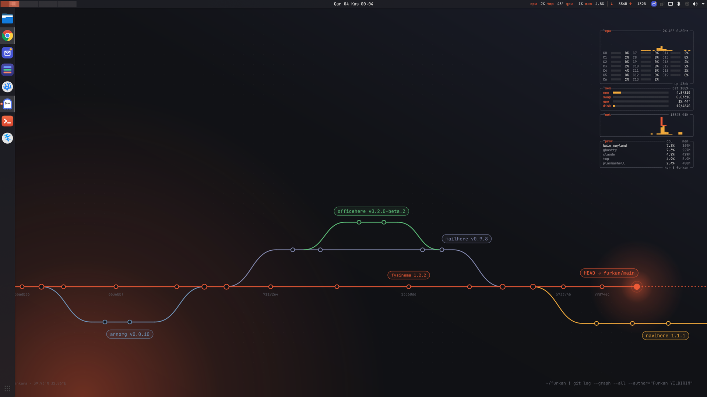
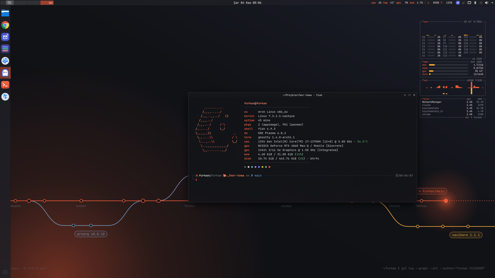
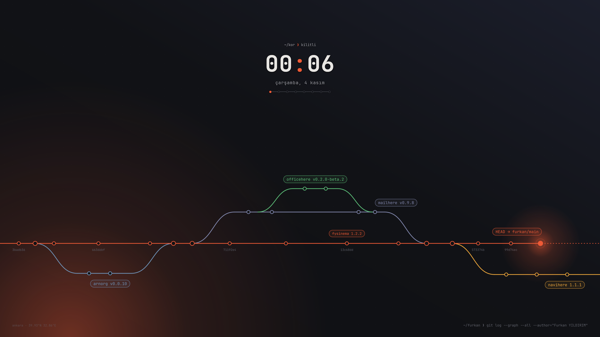
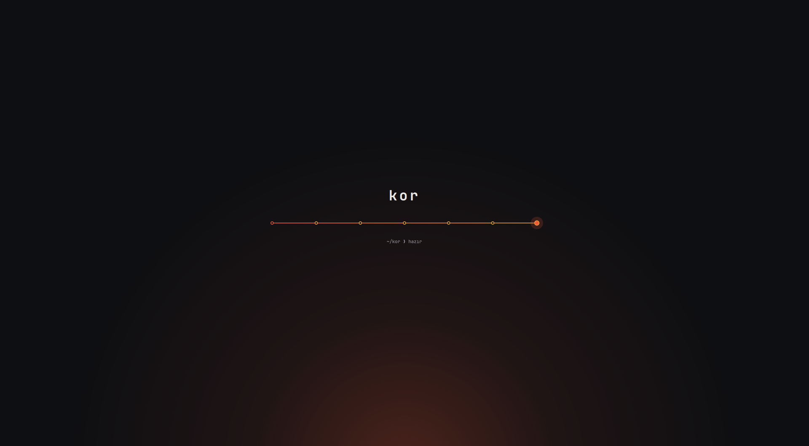
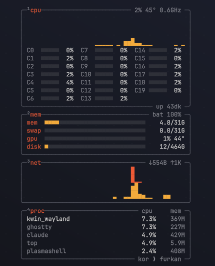

# Kor

Furkan YILDIRIM'ın KDE Plasma 6 masaüstü teması: koyu grafit zemin, tek kor rengi vurgu, solda tam boy dok, üstte ince çubuk ve ortada saat. Duvar kağıdı, Furkan'ın gerçek projelerinin `git log --graph` çizimi.





| Kilit ekranı | Açılış ekranı |
|---|---|
|  |  |



**Kor Masa**, masaüstünde duran btop özetidir: işlemci geçmişi ve 20 çekirdeğin her biri, bellek, takas, ekran kartı, disk, ağ geçmişi ve en yoğun beş süreç. Tamamen ASCII kipinde, arka planı saydam.

Üst çubuktaki **Kor Durum** göstergesi aynı verinin tek satırlık özetini verir: cpu, sıcaklık, gpu, bellek ve ağ.

<br clear="right">

## Tek komutla kurulum

Arch tabanlı bir dağıtımda (CachyOS, Arch, EndeavourOS), Plasma oturumu açıkken kendi kullanıcınla çalıştır:

```bash
bash <(curl -fsSL https://raw.githubusercontent.com/fyildirim-debug/kor-tema/main/kur.sh)
```

Ya da:

```bash
git clone https://github.com/fyildirim-debug/kor-tema.git && bash kor-tema/kur.sh
```

Paket ve giriş ekranı adımlarında sudo parolası sorulur. Bitince oturumu kapatıp yeniden gir: kilit ekranı ve pencere efektleri ancak yeni girişte tam oturur. Plasma oturumu dışında (ör. TTY ya da SSH) çalıştırılırsa dosyalar kurulur, tema ilk girişte kendiliğinden uygulanır.

| Seçenek | İş |
|---|---|
| `--paketsiz` | Paket kurulumunu atlar |
| `--sistemsiz` | Sudo isteyen adımları (paketler, SDDM) atlar |
| `--ertele` | Yalnızca dosyaları kurar, uygulamayı sonraki girişe bırakır |

Kurulum güncelleme için de aynı komutla tekrar çalıştırılabilir. Her çalıştırmada eski ayarlar `~/.local/share/kor-tema/yedek/` altına yedeklenir. `bash geri-al.sh` en son yedeğe döner.

## İçerik

| Parça | Yeri |
|---|---|
| Görünüm paketi (panel düzeni, dok, saat, açılış ekranı) | `org.furkan.kor` |
| Renk şeması | `Kor.colors` |
| Duvar kağıdı | `KorFurkan` (üretici: `araclar/duvar.py`) |
| Üst çubuk göstergesi (cpu, sıcaklık, gpu, bellek, ağ) | `org.furkan.kordurum` |
| Masaüstünde btop özeti, ASCII kipinde | `org.furkan.kormasa` |
| Kilit ekranı | `org.furkan.kor.kilit` kabuk paketi + KWin ortam ayarı |
| Simge teması (Papirus-Dark + kor rengi klasörler) | `Kor` |
| Pencereler: Breeze kenar, yuvarlak köşe, kor–amber çerçeve, bulanıklık | KWin ayarları |
| Ghostty, btop, fastfetch (FY grafiti logosu), starship, zoxide, Kate, GTK | `dosyalar/config` |
| Giriş ekranı: Breeze + Kor duvar kağıdı + Bibata imleç | SDDM |
| Kısayollar: Win → Genel Görünüm, Alt+F1 → uygulama başlatıcı | kglobalaccel |

## Kısayollar ve davranışlar

| Tuş | İş |
|---|---|
| Win | Genel Görünüm: açık pencerelerin hepsi küçük resim olarak, üstte arama ve çalışma alanları |
| Win+W | Genel Görünüm (aynısı) |
| Alt+F1 | Uygulama başlatıcı (doktaki ızgara simgesi) |
| Ctrl+F10 | Bütün çalışma alanlarının pencereleri birlikte |
| Ctrl+Alt+T | Ghostty |

- 4 çalışma alanı var; etkin olanı üst çubuğun solunda kor rengiyle görünür.
- Pencere düğmeleri sağda; etkin pencerenin çerçevesi kor→amber geçişli, ekranı kaplayınca çerçeve kalkar.
- Kor Masa ve Kor Durum tıklamaya tepki vermez; yalnız gösterir.
- Kilit ekranında saat JetBrains Mono, tarih Türkçe; alttaki commit çizgisinde HEAD gün boyunca soldan sağa ilerler.
- Terminal programlarının panoya yazabilmesi için `wl-clipboard` kurulur (Wayland'da Claude Code gibi araçlar `wl-copy` kullanır).

## Bilinen notlar

- Plasma 6 kilit ekranını görünüm paketinden değil kabuk paketinden yükler. Kor, kilit ekranını `org.furkan.kor.kilit` kabuk paketiyle verir ve bu paketi yalnız KWin'e `PLASMA_DEFAULT_SHELL` ile tanıtır (`~/.config/systemd/user/plasma-kwin_wayland.service.d/kor-kilit.conf`). Masaüstü kabuğu etkilenmez. Büyük bir Plasma güncellemesinden sonra kilit ekranı bozuk açılırsa bu dosyayı silip yeniden gir.
- Plasma 6.8'de Win tuşunu tek başına bağlamak `kwinrc` `ModifierOnlyShortcuts` ile değil kglobalaccel üzerinden olur; `uygula.sh` bunu D-Bus ile yapar.
- Dok listesinde Mailhere, OfficeHere, VSCodium ve Claude Code da var; kurulu olmayanların kısayolu görünmez.

Kurulan paketler: `papirus-icon-theme`, `ttf-ubuntu-font-family`, `ttf-jetbrains-mono-nerd`, `ghostty`, `starship`, `zoxide`, `btop`, `fastfetch`, `kate`, `wl-clipboard`, AUR'dan `bibata-cursor-theme-bin`, `kwin-effect-rounded-corners`, `kwin-effects-better-blur-dx`. AUR için paru/yay varsa onu, yoksa doğrudan `makepkg` kullanır.

## Duvar kağıdını yeniden üretmek

```bash
python3 araclar/duvar.py ~/.local/share/wallpapers/KorFurkan/contents/images
```

## FY logosunu yeniden üretmek

Fastfetch'teki FY logosu, `araclar/fy-grafiti.png` grafiti çiziminin renkli Braille noktalarına çevrilmiş hâlidir (Pillow gerekir):

```bash
python3 araclar/fy-braille.py araclar/fy-grafiti.png 38 ~/.config/fastfetch/fy.txt
```

## Lisans

Kor'a ait dosyalar (renk şeması, görünüm paketi, widget'lar, betikler) GPL-2.0-or-later, duvar kağıdı CC-BY-SA-4.0. Kilit ekranı KDE Plasma'nın kilit ekranından türetilmiştir (GPL). Papirus, Bibata, Breeze, KWin eklentileri ve yazı tipleri kendi lisanslarıyla paket olarak kurulur; depoya gömülmez.
